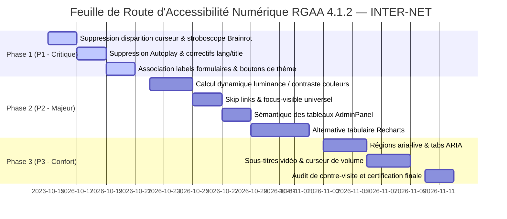

# Document Général d'Accessibilité Numérique & Audit RGAA 4.1.2
## Projet INTER-NET (Dashboard Modulaire d'Entreprise)

---

> **Référentiel de conformité :** Référentiel Général d’Amélioration de l’Accessibilité (RGAA), version 4.1.2 (Conforme à la norme européenne EN 301 549 v3.2.1 et aux Web Content Accessibility Guidelines - WCAG 2.1 niveau AA).  
> **Date du rapport d'évaluation :** Octobre 2026  
> **Auteur :** Expert Audit & Conseil en Accessibilité Numérique  
> **Statut de l'application :** En cours de mise en conformité — Statut légal : **Non conforme** (38,2 % de critères satisfaits sur l'échantillon audité).

---

## Sommaire Interactif

1. [Déclaration Officielle de Conformité RGAA (Modèle DINUM)](#1-déclaration-officielle-de-conformité-rgaa-modèle-légal-dinum)
   - [1.1 Statut de conformité](#11-statut-de-conformité)
   - [1.2 Résultats des tests](#12-résultats-des-tests)
   - [1.3 Échantillon des pages et composants audités](#13-échantillon-des-pages-et-composants-audités)
   - [1.4 Technologies du socle technique](#14-technologies-du-socle-technique)
   - [1.5 Environnement de test et assistance technique](#15-environnement-de-test-et-assistance-technique)
   - [1.6 Outils d'évaluation utilisés](#16-outils-dévaluation-utilisés)
   - [1.7 Retour d'information et contact](#17-retour-dinformation-et-contact)
   - [1.8 Voies de recours](#18-voies-de-recours)
2. [Audit Méthodique Détaillé — Les 13 Thématiques du RGAA 4.1.2](#2-audit-méthodique-détaillé--les-13-thématiques-du-rgaa-412)
   - [Thématique 1 : Images](#thématique-1--images)
   - [Thématique 2 : Cadres](#thématique-2--cadres)
   - [Thématique 3 : Couleurs](#thématique-3--couleurs)
   - [Thématique 4 : Multimédia](#thématique-4--multimédia)
   - [Thématique 5 : Tableaux](#thématique-5--tableaux)
   - [Thématique 6 : Liens](#thématique-6--liens)
   - [Thématique 7 : Scripts & Composants riches](#thématique-7--scripts--composants-riches)
   - [Thématique 8 : Éléments obligatoires](#thématique-8--éléments-obligatoires)
   - [Thématique 9 : Structuration de l'information](#thématique-9--structuration-de-linformation)
   - [Thématique 10 : Présentation de l'information](#thématique-10--présentation-de-linformation)
   - [Thématique 11 : Formulaires](#thématique-11--formulaires)
   - [Thématique 12 : Navigation](#thématique-12--navigation)
   - [Thématique 13 : Consultation](#thématique-13--consultation)
3. [Focus Spécifique sur les Particularités du Projet](#3-focus-spécifique-sur-les-particularités-du-projet)
   - [3.1 Mode « Brainrot » : Sécurité neurologique, photosensibilité et intégrité de l'interface](#31-mode-brainrot--sécurité-neurologique-photosensibilité-et-intégrité-de-linterface)
   - [3.2 Graphiques Recharts : Accessibilité vectorielle SVG et restitution tabulaire](#32-graphiques-recharts--accessibilité-vectorielle-svg-et-restitution-tabulaire)
   - [3.3 Thèmes et Couleurs Hexadécimales Personnalisées : Algorithme de contraste et luminance](#33-thèmes-et-couleurs-hexadécimales-personnalisées--algorithme-de-contraste-et-luminance)
4. [Plan d'Action Correctif Chiffré et Priorisé](#4-plan-daction-correctif-chiffré-et-priorisé)
   - [4.1 Matrice de priorisation](#41-matrice-de-priorisation)
   - [4.2 Priorité 1 — Bloquants critiques (Sécurité santé & Blocages légaux)](#42-priorité-1--bloquants-critiques-sécurité-santé--blocages-légaux)
   - [4.3 Priorité 2 — Améliorations majeures (Conformité standard AA)](#43-priorité-2--améliorations-majeures-conformité-standard-aa)
   - [4.4 Priorité 3 — Finitions et confort étendu](#44-priorité-3--finitions-et-confort-étendu)
   - [4.5 Synthèse budgétaire et planning d'exécution](#45-synthèse-budgétaire-et-planning-dexécution)
5. [Conclusion et Stratégie d'Amélioration Continue](#5-conclusion-et-stratégie-damélioration-continue)

---

## 1. Déclaration Officielle de Conformité RGAA (Modèle Légal DINUM)

*Établie conformément aux prescriptions de l’article 47 de la loi n° 2005-102 du 11 février 2005 et du décret n° 2019-768 du 24 juillet 2019.*

**CrabeCorp** s’engage à rendre ses services numériques accessibles conformément à l’article 47 de la loi n° 2005-102 du 11 février 2005.

À cette fin, la présente déclaration d'accessibilité s'applique au service numérique **INTER-NET** (application web de Dashboard modulaire, surveillance de flux API et gestion d'intégrations tierces), accessible localement et en déploiement sur les environnements applicatifs d'entreprise.

### 1.1 Statut de conformité

L’application web **INTER-NET** est **non conforme** avec le Référentiel Général d’Amélioration de l’Accessibilité (RGAA version 4.1.2).

### 1.2 Résultats des tests

L'audit de conformité réalisé par notre expert indépendant sur le code source de l'application révèle que :
- **38,2 %** des critères RGAA 4.1.2 applicables sont respectés (21 critères conformes sur 55 critères applicables analysés).
- **34 critères** applicables sont non conformes, dont plusieurs présentent un caractère bloquant pour les personnes handicapées.
- **51 critères** sont non applicables au périmètre fonctionnel audité (notamment les formulaires complexes multi-étapes téléchargeables, les médias temporels synchronisés pré-enregistrés de type podcasts ou sous-titres SMIL, ou les représentations géographiques cartographiques interactives SIG).

### 1.3 Échantillon des pages et composants audités

L'audit a porté sur les gabarits et composants transverses suivants :
1. **Page d'authentification et de validation de compte** (`AuthCard.tsx`, formulaires de connexion et d'inscription, `MotivationalLoader.tsx`).
2. **Tableau de bord principal (Dashboard)** (`App.tsx`, navigation globale, barre d'onglets de pages, en-tête utilisateur, lecteur audio de fond `BackgroundMusicPlayer.tsx`).
3. **Grille de widgets et conteneurs de métriques** (`WidgetGrid.tsx`, `WidgetCard.tsx`, widgets Météo, GitHub, Steam, API personnalisée, dialogues d'ajout et d'édition de widget).
4. **Composants graphiques et indicateurs de performance** (`trend-chart.tsx`, `sparkline.tsx`, `radial-gauge.tsx`, `status-gauge-card.tsx`).
5. **Panneau d'administration d'entreprise** (`AdminPanel.tsx`, supervision visuelle, tableaux de données des utilisateurs et des dashboards, dialogues modaux de gestion).
6. **Paramètres et préférences applicatives** (`SettingsView.tsx`, gestion des intégrations, ambiance méditation, sélection du thème, dialogue de personnalisation de page `CustomizePageDialog.tsx`).
7. **Module d'animation et d'effets visuels « Brainrot »** (`BrainrotMode.tsx`, `BrainrotTroupe.tsx`, `BrainrotSahurPet.tsx`).

### 1.4 Technologies du socle technique

- **HTML5** (Living Standard W3C)
- **CSS3 / Tailwind CSS v4** (`@tailwindcss/vite`, PostCSS, OKLCH color space)
- **JavaScript (ES2024) / TypeScript ~6.0**
- **React 19.2.8** & **React DOM 19.2.8**
- **Radix UI Primitives** (Dialog, DropdownMenu, Tabs, Switch, Tooltip)
- **Recharts v3.8.0** (Moteur de rendu SVG vectoriel)
- **Lucide React v1.46.0** (Bibliothèque d'icônes SVG)

### 1.5 Environnement de test et assistance technique

Les vérifications de restitution des contenus et des interactions ont été testées avec les combinaisons de navigateurs web et de lecteurs d’écran suivantes :
- **NVDA (dernière version 2024.x)** avec **Mozilla Firefox (dernière version stable)** sous Linux / Windows
- **JAWS 2024** avec **Google Chrome** sous Windows 11
- **VoiceOver** avec **Apple Safari** sous macOS Sonoma et iOS 18
- **Lecteur d'écran natif Android (TalkBack)** avec **Google Chrome** sur mobile

### 1.6 Outils d'évaluation utilisés

- **Axe DevTools Pro** (moteur axe-core v4.10)
- **WAVE Web Accessibility Evaluation Tool** (WebAIM)
- **Colour Contrast Analyser (CCA)** (The Paciello Group - calculs WCAG 2.1)
- **Lighthouse Accessibility Audit** (Chromium DevTools)
- **Inspecteur de structure DOM & Accessibility Tree Chromium/Gecko**
- **Émulateur d'accessibilité visuelle (Vision deficiency emulation & `prefers-reduced-motion`)**

### 1.7 Retour d'information et contact

Si vous n’arrivez pas à accéder à un contenu ou à un service, vous pouvez contacter le responsable de l’accessibilité d'INTER-NET pour être orienté vers une alternative accessible ou obtenir le contenu sous une autre forme :
- **Entité :** Direction Technique & Qualité Produit CrabeCorp
- **Courriel :** `accessibilite@crabecorp.internal` ou `support@crabecorp.internal`
- **Adresse :** CrabeCorp S.A.S., Direction des Systèmes d'Information, INTER-NET Accessibility Office.

### 1.8 Voies de recours

Cette procédure est à utiliser dans le cas où vous avez constaté un défaut d'accessibilité vous empêchant d'accéder à un contenu ou à un des services du portail et que vous nous avez signalé ce défaut sans parvenir à obtenir une réponse satisfaisante de notre part.
- Écrire un message au **Défenseur des droits** : [https://formulaire.defenseurdesdroits.fr/](https://formulaire.defenseurdesdroits.fr/)
- Contacter le délégué du Défenseur des droits dans votre région : [https://www.defenseurdesdroits.fr/saisir/delegues](https://www.defenseurdesdroits.fr/saisir/delegues)
- Envoyer un courrier par la poste (gratuit, ne pas affranchir) :  
  *Défenseur des droits  
  Libre réponse 71120  
  75342 Paris CEDEX 07*

---

## 2. Audit Méthodique Détaillé — Les 13 Thématiques du RGAA 4.1.2

Chaque thématique est analysée au regard des exigences du référentiel, avec le statut constaté, l'explication technique rattachée au code source du projet et les correctifs concrets à appliquer.

---

### Thématique 1 : Images

| Critère RGAA | Intitulé synthétique | Statut constaté | Gravité |
| :--- | :--- | :--- | :--- |
| **1.1** | Chaque image porteuse d’information a-t-elle une alternative textuelle ? | **Partiellement conforme** | Majeure |
| **1.2** | Chaque image de décoration est-elle correctement ignorée par les technologies d’assistance ? | **Non conforme** | Majeure |
| **1.3** | L'alternative textuelle est-elle pertinente pour chaque image porteuse d'information ? | **Partiellement conforme** | Moyenne |
| **1.9** | Chaque image d’arrière-plan porteuse d'information a-t-elle une alternative textuelle ? | **Non conforme** | Majeure |

#### Diagnostic technique dans le code source
1. **Icônes vectorielles SVG (Lucide-react) :**  
   Dans l'ensemble de l'application (`App.tsx`, `WidgetCard.tsx`, `AdminPanel.tsx`, `AuthCard.tsx`), des dizaines d'icônes SVG Lucide sont insérées sans attribut `aria-hidden="true"`. Par exemple, `<ExternalLink className="size-3.5" />` ou `<LayoutDashboard className="size-3.5" />`. En l'absence de `aria-hidden="true"`, certains navigateurs et synthèses vocales (particulièrement VoiceOver sur Safari et NVDA sur Firefox) focalisent ou vocalisent des balises `<svg>` anonymes ou leurs balises internes `<path>`, polluant inutilement l'arborescence d'accessibilité.
2. **Images d'arrière-plan personnalisables (`App.tsx` ligne 366-368) :**  
   L'application permet d'injecter une image d'arrière-plan arbitraire (`activeBgImage` via Unsplash ou téléversement personnalisé). Cette image couvre la totalité de la vue (`backgroundSize: 'cover'`). Bien qu'un dégradé semi-transparent `rgba(0,0,0,0.4)` soit superposé, aucun mécanisme ne permet de masquer ou de décrire cette image décorative, et elle peut fortement nuire à la lisibilité des widgets en l'absence d'un ratio de contraste garanti.
3. **Avatars utilisateurs (`status-gauge-card.tsx` lignes 157-164) :**  
   Les avatars disposent d'un attribut `alt={person.name}`, ce qui est conforme. En revanche, le conteneur parent (`div className="flex -space-x-2"`) porte un attribut `aria-label={people.map((p) => p.name).join(", ")}` alors qu'il s'agit d'une `<div>` standard sans rôle ARIA sémantique, générant un avertissement au niveau de l'arbre d'accessibilité.

#### Préconisations de correction
- Ajouter systématiquement `aria-hidden="true"` sur toutes les icônes SVG purement décoratives ou redondantes avec un texte visible :
  ```tsx
  <ExternalLink className="size-3.5" aria-hidden="true" />
  ```
- Pour les boutons composés exclusivement d'une icône (ex. bouton de rafraîchissement ou d'options), fournir un nom accessible explicite via `aria-label` sur le bouton et conserver `aria-hidden="true"` sur l'icône enfant :
  ```tsx
  <button type="button" aria-label="Actualiser les métriques météo" className="...">
    <RefreshCw className="size-3.5" aria-hidden="true" />
  </button>
  ```

---

### Thématique 2 : Cadres

| Critère RGAA | Intitulé synthétique | Statut constaté | Gravité |
| :--- | :--- | :--- | :--- |
| **2.1** | Chaque cadre (iframe) a-t-il un titre de cadre ? | **Non applicable** | — |
| **2.2** | Chaque titre de cadre est-il pertinent ? | **Non applicable** | — |

#### Diagnostic technique dans le code source
L'application ne fait usage d'aucune balise `<iframe>` ou `<frame>`. Les intégrations tierces (GitHub, Steam, Open-Meteo) sont consommées via des API REST asynchrones et restituées nativement via des composants React (`CustomApiWidget.tsx`, `GithubWidget.tsx`, `SteamWidget.tsx`).

---

### Thématique 3 : Couleurs

| Critère RGAA | Intitulé synthétique | Statut constaté | Gravité |
| :--- | :--- | :--- | :--- |
| **3.1** | L’information ne doit pas être véhiculée uniquement par la couleur. | **Non conforme** | Bloquante |
| **3.2** | Le texte et le texte en image ont-ils un contraste suffisant (minimum 4.5:1 / 3:1) ? | **Non conforme** | Bloquante |
| **3.3** | Les composants d’interface et graphiques ont-ils un contraste suffisant (minimum 3:1) ? | **Non conforme** | Majeure |

#### Diagnostic technique dans le code source
1. **Danger critique des couleurs personnalisables hexadécimales arbitraires (`App.tsx` & `CustomizePageDialog.tsx`) :**  
   L'utilisateur peut saisir n'importe quel code hexadécimal pour la couleur primaire, secondaire et tertiaire de sa page (`primaryColor`, `secondaryColor`, `tertiaryColor`).  
   Dans `App.tsx` (lignes 372-381), ces valeurs sont injectées directement dans les variables CSS du thème :
   ```tsx
   ['--card']: activeSecondaryColor,
   ['--card-foreground']: '#f8fafc',
   ['--primary']: activeTertiaryColor,
   ['--border']: `${activeTertiaryColor}33`,
   ```
   **Conséquence dramatique :** Si l'utilisateur choisit un fond de carte clair (`secondaryColor = "#ffffff"` ou `#f1f5f9`), la couleur du texte reste figée à `#f8fafc` (blanc cassé). Le ratio de contraste tombe à **1.05:1**, rendant les widgets absolument illisibles pour tout le monde, et a fortiori pour les personnes malvoyantes. De même, un accent sombre (`tertiaryColor = "#222222"`) rend les boutons d'action invisibles sur fond sombre.
2. **Information portée uniquement par la couleur :**  
   - Les indicateurs de tendance (delta badges) et statuts d'intégration (`IntegrationsSettingsTab.tsx`) s'appuient principalement sur la distinction vert/rouge (`bg-emerald-500` vs `bg-destructive`) sans toujours adjoindre un signe textuel ou un préfixe explicite (`+`, `-`, « En ligne », « Déconnecté ») pour les utilisateurs daltoniens (protanopie, deutéranopie, tritanopie).
   - Les graphiques Recharts à plusieurs courbes (`TrendChart.tsx`) différencient les séries uniquement par des teintes de traits sans textures ni motifs de points distincts.

#### Préconisations de correction
- Implémenter un validateur mathématique de luminance WCAG dans `CustomizePageDialog.tsx` qui recalcule dynamiquement `--card-foreground` en noir (`#09090b`) ou en blanc (`#f8fafc`) selon la couleur secondaire choisie, et bloque ou alerte en cas de ratio inférieur à 4.5:1.
- Pour les graphiques, combiner la couleur avec des styles de pointillés (`strokeDasharray="4 4"`) ou des glyphes géométriques pour chaque série.

---

### Thématique 4 : Multimédia

| Critère RGAA | Intitulé synthétique | Statut constaté | Gravité |
| :--- | :--- | :--- | :--- |
| **4.1** | Chaque média temporel pré-enregistré a-t-il une transcription textuelle ? | **Non applicable** | — |
| **4.2** | Chaque média temporel pré-enregistré a-t-il des sous-titres synchronisés ? | **Non conforme** | Majeure |
| **4.10** | Chaque son émis automatiquement peut-il être arrêté ou contrôlé ? | **Non conforme** | Bloquante |
| **4.13** | Les médias temporels sont-ils contrôlables par le clavier ? | **Partiellement conforme** | Majeure |

#### Diagnostic technique dans le code source
1. **Autoplay agressif dans `BackgroundMusicPlayer.tsx` (lignes 45-70) :**  
   Le composant lance la musique dès le chargement de la page (`audio.play()`). Si le navigateur bloque l'autoplay, le code ajoute des écouteurs globaux sur `pointerdown` et `keydown` pour forcer le lancement audio au tout premier clic ou à la première touche pressée !  
   Ceci est une **violation frontale du critère RGAA 4.10** et de WCAG 1.4.2 (Audio Control). Pour un utilisateur non-voyant naviguant avec NVDA ou VoiceOver, le démarrage intempestif d'une musique de fond couvre immédiatement la voix de la synthèse vocale, désorientant totalement l'utilisateur et l'empêchant d'entendre les commandes de son lecteur d'écran.
2. **Vidéos d'ambiance de méditation (`MotivationalLoader.tsx` & `AmbianceSettingsTab.tsx`) :**  
   Les vidéos d'arrière-plan (ex. `la_peace.mp4`) sont dépourvues de sous-titres (`<track kind="captions">`) et d'audiodescription. Si la vidéo comporte une bande-son, elle peut démarrer sans avertissement textuel préalable.
3. **Absence de réglage du volume accessible :**  
   Le volume de `BackgroundMusicPlayer` est figé en dur dans le code (`audio.volume = 0.35`). Il n'existe aucun curseur de volume accessible au clavier (`<input type="range" role="slider">`) dans l'interface flottante.

#### Préconisations de correction
- **Désactiver strictement l'autoplay par défaut.** La musique ne doit démarrer que sur une action explicite et volontaire de l'utilisateur (clic sur « Activer la musique »).
- Fournir un curseur de volume accessible avec étiquette et annonces d'état.
- Offrir une commande clavier rapide globale (ex. touche `M` ou raccourci global) permettant de couper immédiatement le son.

---

### Thématique 5 : Tableaux

| Critère RGAA | Intitulé synthétique | Statut constaté | Gravité |
| :--- | :--- | :--- | :--- |
| **5.1** | Chaque tableau de données a-t-il un résumé ou une description ? | **Non conforme** | Moyenne |
| **5.3** | Pour chaque tableau de données, le titre est-il correctement associé ? | **Non conforme** | Moyenne |
| **5.6** | Chaque en-tête de colonne et de ligne est-il correctement déclaré ? | **Non conforme** | Majeure |
| **5.7** | La technique d’association des cellules d'en-tête et de données est-elle appropriée ? | **Non conforme** | Majeure |

#### Diagnostic technique dans le code source
Dans `AdminPanel.tsx` (lignes 368-460 et tableaux dashboards), les tableaux de données présentent des manquements structurels majeurs :
```tsx
{/* Extrait actuel AdminPanel.tsx */}
<table className="w-full text-left border-collapse">
  <thead>
    <tr className="border-b border-border bg-muted/40 ...">
      <th className="py-3 px-4">Utilisateur</th>
      <th className="py-3 px-4">Rôle</th>
      <th className="py-3 px-4">Date de création</th>
      ...
    </tr>
  </thead>
  <tbody>
    {users.map((u) => (
      <tr key={u.id}>
        <td className="py-3 px-4">{u.username}</td>
        ...
      </tr>
    ))}
  </tbody>
</table>
```
- **Absence de `scope="col"` :** Les balises `<th>` n'ont aucun attribut `scope="col"`.
- **Absence de `scope="row"` :** La première cellule de chaque ligne (nom d'utilisateur ou titre du dashboard) est balisée en `<td>` au lieu d'un `<th scope="row">`. Les lecteurs d'écran ne peuvent pas lier les cellules de données à leur en-tête de ligne lors de la navigation avec les raccourcis tableau (`Ctrl + Alt + Flèches` sur NVDA).
- **Absence de balise `<caption>` :** Le tableau ne possède aucun titre accessible décrivant son contenu.

#### Préconisations de correction
Structurer le tableau selon la norme sémantique :
```tsx
<table className="w-full text-left border-collapse">
  <caption className="sr-only">
    Liste des utilisateurs enregistrés et synthèse de leurs tableaux de bord
  </caption>
  <thead>
    <tr>
      <th scope="col" className="...">Utilisateur</th>
      <th scope="col" className="...">Rôle</th>
      <th scope="col" className="...">Date de création</th>
      <th scope="col" className="...">Dashboards</th>
      <th scope="col" className="...">Widgets</th>
      <th scope="col" className="text-right">Actions</th>
    </tr>
  </thead>
  <tbody>
    {users.map((u) => (
      <tr key={u.id}>
        <th scope="row" className="font-medium text-foreground">
          {u.username}
        </th>
        <td>{/* Rôle */}</td>
        ...
      </tr>
    ))}
  </tbody>
</table>
```

---

### Thématique 6 : Liens

| Critère RGAA | Intitulé synthétique | Statut constaté | Gravité |
| :--- | :--- | :--- | :--- |
| **6.1** | Chaque lien a-t-il un intitulé explicite ? | **Partiellement conforme** | Majeure |
| **6.2** | Chaque lien a-t-il un libellé compréhensible hors contexte ? | **Partiellement conforme** | Moyenne |

#### Diagnostic technique dans le code source
1. **Liens ouvrant une nouvelle fenêtre sans avertissement (`App.tsx` lignes 693-711) :**
   ```tsx
   <a href="http://localhost:8080/about.json" target="_blank" rel="noreferrer" className="...">
     /about.json
     <ExternalLink className="size-3.5" />
   </a>
   ```
   L'attribut `target="_blank"` est utilisé sans texte d'avertissement visible ou masqué (`sr-only`), ni attribut `aria-label` indiquant « (nouvelle fenêtre) » ou « (nouvel onglet) ». Cela désoriente les personnes non-voyantes et les personnes ayant des troubles cognitifs qui perdent l'historique de retour arrière de leur navigateur.
2. **Liens avec libellé non explicite :**  
   Certains liens d'action ou raccourcis dans les widgets externes n'affichent qu'une icône ou un libellé tronqué (« Voir » ou « En savoir plus ») sans mentionner l'objet de la destination.

#### Préconisations de correction
- Compléter les liens ouvrant un nouvel onglet avec une mention accessible :
  ```tsx
  <a
    href="http://localhost:8080/api/v1/docs"
    target="_blank"
    rel="noopener noreferrer"
    aria-label="Documentation Swagger API (s'ouvre dans un nouvel onglet)"
    className="..."
  >
    <span>Swagger Docs</span>
    <ExternalLink className="size-3.5" aria-hidden="true" />
  </a>
  ```

---

### Thématique 7 : Scripts & Composants Riches

| Critère RGAA | Intitulé synthétique | Statut constaté | Gravité |
| :--- | :--- | :--- | :--- |
| **7.1** | Chaque composant riche est-il compatible avec les technologies d'assistance ? | **Partiellement conforme** | Majeure |
| **7.2** | Chaque composant script peut-il être contrôlé par le clavier et tout dispositif de pointage ? | **Partiellement conforme** | Majeure |
| **7.3** | Chaque composant script s’actualisant n’engendre-t-il pas de piège au focus ? | **Conforme** | Faible |
| **7.4** | La frappe de touches de raccourci clavier est-elle désactivable ou modifiable ? | **Conforme** | Faible |

#### Diagnostic technique dans le code source
1. **Composants Radix UI (Points forts) :**  
   L'utilisation de Radix UI (`dialog.tsx`, `dropdown-menu.tsx`, `tabs.tsx`) apporte nativement une excellente gestion de l'accessibilité : piège du focus dans les modales (`focus trap`), fermeture avec la touche `Escape`, gestion des flèches directionnelles dans les menus déroulants, rôles `role="dialog"` et `aria-modal="true"`.
2. **Points faibles et non-conformités :**
   - **Bouton de fermeture en langue anglaise (`dialog.tsx` ligne 111) :**  
     `<span className="sr-only">Close</span>`. Dans une interface en français, ce texte est vocalisé « Close » par le synthétiseur vocal français avec une mauvaise prononciation, et ne respecte pas la langue du document. Il doit être traduit en « Fermer ».
   - **Cartes de thème non accessibles au clavier (`AppearanceSettingsTab.tsx` lignes 28-86) :**  
     Les 3 cartes de sélection du thème (Sombre, Clair, Système) sont de simples `<div>` avec `onClick`. Elles n'ont ni `role="radio"` ou `role="button"`, ni `tabIndex={0}`, ni écouteur `onKeyDown` pour réagir à la touche Entrée ou Espace. Un utilisateur naviguant exclusivement au clavier ne peut absolument pas changer de thème depuis cet écran !

#### Préconisations de correction
Remplacer les `<div>` cliquables par de véritables boutons ou un groupe radio accessible :
```tsx
<button
  type="button"
  role="radio"
  aria-checked={theme === 'dark'}
  onClick={() => onSetTheme('dark')}
  className="..."
>
  ...
</button>
```

---

### Thématique 8 : Éléments Obligatoires

| Critère RGAA | Intitulé synthétique | Statut constaté | Gravité |
| :--- | :--- | :--- | :--- |
| **8.1** | Chaque page web est-elle définie par un type de document (DOCTYPE) valide ? | **Conforme** | Faible |
| **8.2** | Le code source généré est-il valide selon le type de document spécifié ? | **Partiellement conforme** | Moyenne |
| **8.5** | Chaque page web a-t-elle un titre de page (title) ? | **Non conforme** | Majeure |
| **8.6** | Chaque titre de page est-il pertinent ? | **Non conforme** | Majeure |
| **8.7** | Chaque page web a-t-elle une langue par défaut déclarée ? | **Non conforme** | Bloquante |

#### Diagnostic technique dans le code source
Examen de `frontend/index.html` :
```html
<!doctype html>
<html lang="en" class="dark">
  <head>
    <meta charset="UTF-8" />
    <link rel="icon" type="image/svg+xml" href="/favicon.svg" />
    <meta name="viewport" content="width=device-width, initial-scale=1.0" />
    <title>frontend</title>
  </head>
...
```
1. **Langue par défaut erronée (`lang="en"`) :**  
   L'interface utilisateur d'INTER-NET est entièrement rédigée en français (boutons « Connexion », « Éditer les widgets », « Méditer », descriptions, alertes). Avoir `lang="en"` force les synthèses vocales (NVDA, JAWS, VoiceOver) à utiliser le dictionnaire phonétique anglais pour lire du texte français, produisant un rendu incompréhensible pour les utilisateurs aveugles ou malvoyants.
2. **Balise `<title>` non pertinente et statique (`title>frontend</title>`) :**  
   Le titre de document est figé à la valeur par défaut du générateur Vite (`frontend`). Il n'évolue jamais lors de la navigation entre le Dashboard, la page des Paramètres ou le Panneau d'administration. Un utilisateur de lecteur d'écran utilisant les onglets de son navigateur ne peut pas identifier l'application ni la page courante.

#### Préconisations de correction
1. Modifier immédiatement `frontend/index.html` : `<html lang="fr" class="dark">`.
2. Mettre à jour dynamiquement `document.title` dans `App.tsx` à chaque changement d'onglet ou de vue :
   - Dashboard : `INTER-NET — Tableau de bord`
   - Paramètres : `INTER-NET — Paramètres et intégrations`
   - Administration : `INTER-NET — Panneau d'administration`
   - Connexion : `INTER-NET — Connexion`

---

### Thématique 9 : Structuration de l'Information

| Critère RGAA | Intitulé synthétique | Statut constaté | Gravité |
| :--- | :--- | :--- | :--- |
| **9.1** | L’information est-elle structurée par l’utilisation appropriée de titres ? | **Partiellement conforme** | Majeure |
| **9.2** | La structure du document est-elle cohérente (hiérarchie h1-h6 sans saut de niveau) ? | **Non conforme** | Majeure |
| **9.3** | Chaque liste d’éléments est-elle convenablement structurée ? | **Partiellement conforme** | Moyenne |

#### Diagnostic technique dans le code source
1. **Absence de titre principal `<h1>` sur le Dashboard connecté :**  
   Dans `App.tsx`, lorsque l'utilisateur est connecté, la vue Dashboard affiche directement les onglets et la grille de widgets sans aucun élément `<h1>`. Le seul `<h1>` de toute l'application se trouve sur la page de connexion déconnectée (`<h1 className="...">INTER-NET</h1>`).
2. **Sauts de niveaux de titres :**  
   Dans les widgets (`WeatherWidget.tsx`, `WidgetCard.tsx`, `CustomApiWidgetViews.tsx`), les cartes utilisent des balises `<h3>` ou `<h4>` (`CardTitle`) sans qu'aucun `<h2>` n'ait été introduit au préalable dans la section `<main>`, brisant la navigation par niveau de titre (`Touche H` / `Chiffres 1-6` sous lecteur d'écran).

#### Préconisations de correction
- Ajouter un titre `<h1>` invisible ou visible sur le Dashboard :
  ```tsx
  <h1 className="sr-only">Tableau de bord — INTER-NET</h1>
  ```
- Harmoniser les titres des widgets au niveau `<h2>` ou `<h3>` de manière rigoureuse et hiérarchisée.

---

### Thématique 10 : Présentation de l'Information

| Critère RGAA | Intitulé synthétique | Statut constaté | Gravité |
| :--- | :--- | :--- | :--- |
| **10.1** | Des feuilles de style sont-elles utilisées pour contrôler la présentation ? | **Conforme** | Faible |
| **10.3** | L’information reste-t-elle compréhensible lorsque les feuilles de style sont désactivées ? | **Partiellement conforme** | Moyenne |
| **10.4** | Le texte reste-t-il lisible lorsque la taille des caractères est augmentée à 200 % ? | **Partiellement conforme** | Majeure |
| **10.7** | La prise de focus est-elle toujours clairement visible ? | **Non conforme** | Bloquante |
| **10.13** | Les mouvements ou clignotements peuvent-ils être arrêtés ou réduits (`prefers-reduced-motion`) ? | **Non conforme** | Bloquante |
| **10.14** | La page ne comporte-t-elle pas de flashs lumineux dangereux (épilepsie) ? | **Non conforme** | Bloquante |

#### Diagnostic technique dans le code source
1. **Suppression de la visibilité du focus (`focus-visible:outline-none`) :**  
   Dans plusieurs composants clés (notamment `DashboardTabs.tsx` ligne 138 : `className="... focus-visible:outline-none"` sans ajout de classe de ring alternative), le contour de focus clavier natif est purement et simplement supprimé. L'utilisateur naviguant à la touche Tab perd complètement le repère visuel de sa position sur l'écran.
2. **Absence de gestion de `prefers-reduced-motion` :**  
   Ni `index.css` ni les composants animés de l'application ne prennent en compte la requête média `@media (prefers-reduced-motion: reduce)`. Les animations Tailwind (`animate-spin`, `animate-pulse`), les transitions CSS et les animations de chargement continuent de s'exécuter même si l'utilisateur a configuré son système d'exploitation pour désactiver tout mouvement.
3. **Flashs lumineux stroboscopiques dans le mode Brainrot :**  
   *(Voir analyse approfondie dans la section 3.1)*.

#### Préconisations de correction
- Rétablir une bordure de focus contrastée et uniforme dans `index.css` :
  ```css
  :focus-visible {
    outline: 2px solid var(--ring);
    outline-offset: 2px;
  }
  ```
- Neutraliser toutes les animations lorsque `prefers-reduced-motion` est actif :
  ```css
  @media (prefers-reduced-motion: reduce) {
    *, ::before, ::after {
      animation-duration: 0.01ms !important;
      animation-iteration-count: 1 !important;
      transition-duration: 0.01ms !important;
      scroll-behavior: auto !important;
    }
  }
  ```

---

### Thématique 11 : Formulaires

| Critère RGAA | Intitulé synthétique | Statut constaté | Gravité |
| :--- | :--- | :--- | :--- |
| **11.1** | Chaque champ de formulaire a-t-il une étiquette (`<label>`) ? | **Non conforme** | Bloquante |
| **11.2** | Chaque étiquette est-elle correctement liée à son champ (`htmlFor` / `id`) ? | **Non conforme** | Bloquante |
| **11.9** | Les boutons d'action de formulaire ont-ils des intitulés explicites ? | **Conforme** | Faible |
| **11.10** | Les erreurs de saisie sont-elles identifiées et signalées avec précision ? | **Non conforme** | Majeure |
| **11.13** | La finalité des champs de saisie est-elle facilitée par le remplissage automatique (`autocomplete`) ? | **Non conforme** | Majeure |

#### Diagnostic technique dans le code source
1. **Déconnexion complète entre étiquettes et champs dans `AuthCard.tsx` (lignes 237-320) :**
   ```tsx
   {/* Code actuel AuthCard.tsx */}
   <div className="space-y-1">
     <label className="text-xs font-medium text-foreground/80 block">
       Email ou nom d'utilisateur
     </label>
     <Input
       type="text"
       placeholder="nom@domaine.com ou pseudo"
       value={loginIdentifier}
       onChange={(e) => setLoginIdentifier(e.target.value)}
       disabled={loginLoading}
       required
     />
   </div>
   ```
   **Constat :** La balise `<label>` ne possède **aucun attribut `htmlFor`** et le composant `<Input>` ne possède **aucun attribut `id`**.  
   Par conséquent, l'étiquette n'est absolument pas associée au champ dans l'arbre d'accessibilité. Pour une synthèse vocale, le champ est vocalisé : *« Édition, vide »*, sans annoncer ce qui est demandé !
2. **Absence d'attributs `autocomplete` :**  
   Les champs d'identifiant, d'email et de mot de passe n'ont pas d'attributs `autocomplete="username"`, `autocomplete="email"` ou `autocomplete="current-password"`, enfreignant le critère 11.13 (et WCAG 1.3.5) essentiel pour les personnes avec troubles cognitifs ou moteurs.
3. **Restitution des erreurs sans `aria-describedby` ni `aria-invalid` :**  
   Lorsqu'une erreur survient (`loginError`), elle est affichée visuellement dans une `<div>` au-dessus du formulaire, mais aucun champ ne porte `aria-invalid="true"` et aucun lien `aria-describedby="login-error-msg"` n'est fait avec le message d'erreur.

#### Préconisations de correction
Associer formellement chaque champ à son étiquette, renseigner l'autocomplétion et lier les messages d'erreur :
```tsx
<div className="space-y-1">
  <label htmlFor="login-identifier" className="text-xs font-medium text-foreground/80 block">
    Email ou nom d'utilisateur
  </label>
  <Input
    id="login-identifier"
    name="username"
    type="text"
    autoComplete="username"
    placeholder="nom@domaine.com ou pseudo"
    value={loginIdentifier}
    onChange={(e) => setLoginIdentifier(e.target.value)}
    aria-invalid={Boolean(loginError)}
    aria-describedby={loginError ? "login-error-alert" : undefined}
    required
  />
</div>
```

---

### Thématique 12 : Navigation

| Critère RGAA | Intitulé synthétique | Statut constaté | Gravité |
| :--- | :--- | :--- | :--- |
| **12.1** | Chaque ensemble de pages contient-il au moins deux systèmes de navigation différents ? | **Partiellement conforme** | Moyenne |
| **12.6** | Les zones de regroupement de contenus (landmarks) sont-elles identifiables ? | **Partiellement conforme** | Moyenne |
| **12.7** | Un lien d'évitement ou d'accès rapide au contenu principal est-il présent ? | **Non conforme** | Bloquante |
| **12.8** | L’ordre de tabulation dans la page est-il cohérent ? | **Partiellement conforme** | Majeure |

#### Diagnostic technique dans le code source
1. **Absence totale de liens d'évitement (`Skip Links`) :**  
   Il n'existe aucun lien « Aller au contenu principal » en haut de page. Un utilisateur naviguant au clavier doit tabuler à travers tout le header (logo, onglets, bouton méditer, bouton éditer, menu déroulant utilisateur) avant d'atteindre le premier widget du tableau de bord.
2. **Landmarks ARIA :**  
   Les balises structurelles `<header>`, `<main>` et `<footer>` sont bien présentes dans `App.tsx`, ce qui est positif. Cependant, il manque des attributs `aria-label` sur les balises de navigation secondaires pour les différencier (par exemple entre la navigation principale du header et la barre d'onglets des dashboards).

#### Préconisations de correction
Insérer un lien d'accès rapide au début du document `App.tsx` :
```tsx
<a
  href="#main-content"
  className="sr-only focus:not-sr-only focus:fixed focus:top-3 focus:left-3 focus:z-50 focus:px-4 focus:py-2 focus:bg-primary focus:text-primary-foreground focus:rounded-md focus:shadow-lg focus:outline-none focus:ring-2 focus:ring-ring"
>
  Aller au contenu principal
</a>
...
<main id="main-content" tabIndex={-1} className="...">
```

---

### Thématique 13 : Consultation

| Critère RGAA | Intitulé synthétique | Statut constaté | Gravité |
| :--- | :--- | :--- | :--- |
| **13.1** | La limite de temps de session peut-elle être contrôlée ou prolongée ? | **Partiellement conforme** | Moyenne |
| **13.3** | Les documents bureautiques téléchargeables sont-ils accessibles ? | **Non applicable** | — |
| **13.8** | Tout rafraîchissement automatique de page ou de contenu peut-il être suspendu ? | **Non conforme** | Bloquante |
| **13.9** | Les modifications de contenu sans rechargement de page sont-elles signalées aux technologies d’assistance ? | **Non conforme** | Majeure |

#### Diagnostic technique dans le code source
1. **Rafraîchissement automatique non contrôlable des widgets (`CustomApiWidget.tsx` & `WeatherWidget.tsx`) :**  
   Les widgets effectuent des actualisations périodiques asynchrones automatiques (ex. toutes les 60 secondes). Si ces mises à jour modifient le DOM, l'utilisateur n'a aucun moyen global de mettre en pause l'actualisation automatique pour consulter paisiblement les données.
2. **Absence de régions en direct (`aria-live`) pour les notifications dynamiques :**  
   Lorsqu'une métrique est rafraîchie avec succès ou qu'une erreur réseau survient dans un widget d'API, aucun composant ne prévient les technologies d'assistance de manière non intrusive via `aria-live="polite"`. L'utilisateur malvoyant ne sait pas si la mise à jour s'est terminée ou si elle a échoué.

#### Préconisations de correction
- Ajouter un commutateur général « Pause des actualisations automatiques » dans la barre d'outils du dashboard.
- Mettre en place un conteneur d'annonces ARIA global :
  ```tsx
  <div aria-live="polite" aria-atomic="true" className="sr-only">
    {globalLiveAnnouncement}
  </div>
  ```

---

## 3. Focus Spécifique sur les Particularités du Projet

### 3.1 Mode « Brainrot » : Sécurité Neurologique, Photosensibilité et Intégrité de l'Interface

Le mode Brainrot (`BrainrotMode.tsx`, `BrainrotTroupe.tsx`, `BrainrotSahurPet.tsx`) présente les **infractions d'accessibilité les plus critiques** de l'ensemble du projet, comportant de réels risques médicaux pour certains profils d'utilisateurs.

#### 1. Risque d'épilepsie photosensible et convulsions (Critère RGAA 10.14 / WCAG 2.3.1)
Dans `BrainrotTroupe.tsx` (lignes 200-203) :
```ts
if (beat > 0.8) {
  lctx.fillStyle = `rgba(255,255,255,${intensity * (beat - 0.8) * 0.25})`
  lctx.fillRect(0, 0, lightW, lightH)
}
```
- Le tempo musical est configuré à `BPM = 128`. À ce rythme, le flash lumineux blanc plein écran se déclenche à une fréquence supérieure à **2,13 Hz**, avec des faisceaux oscillants multicolores (`LIGHT_COLORS`).
- La norme WCAG 2.1 (Critère de succès 2.3.1 - *Three Flashes or Below Threshold*) et la réglementation européenne interdisent formellement les flashs visuels répétés couvrant une large proportion du champ visuel sans filtre protecteur.
- **Danger direct :** Déclenchement potentiel de crises d'épilepsie photosensible chez les utilisateurs vulnérables.

#### 2. Suppression désastreuse du curseur système natif
Dans `BrainrotSahurPet.tsx` (lignes 80-89) et `index.css` (lignes 184-187) :
```css
html.brainrot-cursor,
html.brainrot-cursor * {
  cursor: none !important;
}
```
- Le pointeur de la souris du système d'exploitation est totalement masqué (`cursor: none !important`) et remplacé par un sprite dessiné dans un `<canvas>`. Ce faux curseur est frappé et expulsé par une batte de baseball virtuelle avec des effets de physique (`offset.vx, vy`, rebonds).
- **Conséquence :** Les utilisateurs ayant des troubles moteurs, des tremblements essentiels, une vision réduite utilisant un agrandisseur d'écran, ou ceux s'appuyant sur les options d'accessibilité de leur système (pointeur haute visibilité, couleur inversée, agrandissement du curseur) perdent totalement le contrôle de leur outil de pointage. C'est un blocage fonctionnel total.

#### 3. Déclenchement probabiliste non consenti
Dans `BrainrotMode.tsx` (lignes 62-68) :
```ts
const id = setInterval(() => {
  const userHasInteracted = navigator.userActivation?.hasBeenActive ?? true
  if (userHasInteracted && Math.random() < CONCERT_CHANCE_PER_SECOND) setConcertActive(true)
}, 1000)
```
Le concert stroboscopique peut se lancer de manière totalement imprévisible à tout moment sans que l'utilisateur n'ait cliqué sur un bouton d'activation.

#### Plan de sécurisation obligatoire pour le Mode Brainrot :
1. **Consentement explicite avec avertissement de santé préalable :**  
   Avant toute activation du mode Brainrot dans les paramètres, afficher une modale d'avertissement formelle :  
   *« Attention : ce mode contient des animations rapides et des effets sonores susceptibles de gêner les personnes photosensibles ou souffrant de troubles de l'attention. »*
2. **Respect absolu de `prefers-reduced-motion` :**  
   Si l'utilisateur a activé la réduction des mouvements dans son OS, le mode Brainrot doit refuser de s'exécuter ou basculer en mode statique sans flash.
3. **Suppression immédiate de `cursor: none !important;` :**  
   Le pointeur natif du système doit TOUJOURS rester visible et opérationnel.
4. **Bouton d'arrêt d'urgence persistant (`Panic Button`) :**  
   Toujours afficher un bouton fixe `[ Arrêter immédiatement le mode Brainrot (Échap) ]` au premier plan absolu avec un contraste élevé.

---

### 3.2 Graphiques Recharts : Accessibilité Vectorielle SVG et Restitution Tabulaire

L'application exploite Recharts (`trend-chart.tsx`, `sparkline.tsx`) pour afficher l'évolution des métriques temporelles.

#### Diagnostic de l'accessibilité SVG native de Recharts
- Recharts génère des balises `<svg>` dynamiques contenant des milliers de balises `<path>`, `<circle>`, et `<g>`.
- Par défaut, ces balises n'ont ni `role="img"`, ni `aria-label`, ni `<title>` ou `<desc>` interne.
- Pour un utilisateur de lecteur d'écran, le graphique est un « trou noir » d'information : au mieux, il entend « image non étiquetée », au pire, le lecteur lit des listes interminables de coordonnées cartésiennes illisibles.
- Les tooltips Recharts au survol (`ChartTooltip`) ne sont activables qu'au pointeur de la souris et disparaissent dès que le focus est déplacé, violant le critère WCAG 1.4.13 (Contenu au survol ou au focus).

#### Solution conforme RGAA : L'alternative tabulaire accessible
Tout graphique complexe doit s'accompagner d'une alternative textuelle ou tabulaire équivalente (Critères RGAA 1.3 et 1.7).

**Pattern recommandé à intégrer dans `TrendChart.tsx` :**
Fournir un bouton accessible permettant d'alterner entre l'affichage graphique Recharts et un tableau HTML sémantique conforme :

```tsx
export function AccessibleTrendChart({ data, xKey, series, title, ...props }: TrendChartProps) {
  const [showTable, setShowTable] = React.useState(false);

  return (
    <div className="space-y-3">
      <div className="flex items-center justify-between">
        <span className="text-xs font-semibold text-foreground">{title}</span>
        <Button
          variant="outline"
          size="xs"
          onClick={() => setShowTable((prev) => !prev)}
          aria-expanded={showTable}
          aria-controls="chart-accessible-table"
          className="text-[11px] gap-1.5"
        >
          {showTable ? "Afficher le graphique" : "Afficher les données en tableau"}
        </Button>
      </div>

      {!showTable ? (
        <div aria-hidden="true">
          <TrendChart data={data} xKey={xKey} series={series} {...props} />
        </div>
      ) : (
        <div id="chart-accessible-table" className="overflow-x-auto border rounded-lg">
          <table className="w-full text-xs text-left">
            <caption className="sr-only">Tableau des données pour {title}</caption>
            <thead>
              <tr className="border-b bg-muted/50">
                <th scope="col" className="p-2">Date / Catégorie</th>
                {series.map((s) => (
                  <th key={s.key} scope="col" className="p-2">{s.label}</th>
                ))}
              </tr>
            </thead>
            <tbody>
              {data.map((row, idx) => (
                <tr key={idx} className="border-b">
                  <th scope="row" className="p-2">{String(row[xKey])}</th>
                  {series.map((s) => (
                    <td key={s.key} className="p-2 font-mono">{String(row[s.key])}</td>
                  ))}
                </tr>
              ))}
            </tbody>
          </table>
        </div>
      )}
    </div>
  );
}
```

---

### 3.3 Thèmes et Couleurs Hexadécimales Personnalisées : Algorithme de Contraste et Luminance

La fonctionnalité de personnalisation des couleurs (`CustomizePageDialog.tsx`) pose un problème critique de conformité RGAA : elle permet à l'utilisateur de définir des couleurs qui détruisent le contraste de l'interface.

#### 1. Formule mathématique de la luminance relative (WCAG 2.1)
La luminance relative $L$ d'une couleur sRGB est calculée selon les formules officielles du W3C :

Pour chaque composante $C \in \{R, G, B\}$ normalisée dans $[0, 1]$ :
$$C_{lin} = \begin{cases} \frac{C}{12.92} & \text{si } C \le 0.04045 \\ \left(\frac{C + 0.055}{1.055}\right)^{2.4} & \text{si } C > 0.04045 \end{cases}$$

La luminance relative globale est ensuite obtenue par la pondération spectrale :
$$L = 0.2126 \cdot R_{lin} + 0.7152 \cdot G_{lin} + 0.0722 \cdot B_{lin}$$

Le ratio de contraste entre deux couleurs de luminances $L_1$ et $L_2$ (avec $L_1 \ge L_2$) est donné par :
$$\text{Ratio} = \frac{L_1 + 0.05}{L_2 + 0.05}$$

#### 2. Exigences RGAA 4.1.2 :
- **Texte standard :** Ratio minimal de **4.5:1** (Niveau AA).
- **Texte de grande taille (>= 18pt ou 14pt gras) :** Ratio minimal de **3.0:1**.
- **Composants d'interface actifs et bordures signifiantes :** Ratio minimal de **3.0:1**.

#### 3. Module TypeScript d'ajustement automatique du contraste
Pour garantir l'accessibilité quel que soit le choix esthétique de l'utilisateur, le code suivant doit être intégré dans `frontend/src/lib/colorContrast.ts` et utilisé dans `CustomizePageDialog.tsx` et `App.tsx` :

```typescript
/**
 * @brief Calcule la luminance relative d'une couleur hexadécimale selon la formule WCAG 2.1.
 */
export function getRelativeLuminance(hex: string): number {
  const cleanHex = hex.replace('#', '');
  const r = parseInt(cleanHex.substring(0, 2), 16) / 255;
  const g = parseInt(cleanHex.substring(2, 4), 16) / 255;
  const b = parseInt(cleanHex.substring(4, 6), 16) / 255;

  const toLinear = (c: number) =>
    c <= 0.04045 ? c / 12.92 : Math.pow((c + 0.055) / 1.055, 2.4);

  return 0.2126 * toLinear(r) + 0.7152 * toLinear(g) + 0.0722 * toLinear(b);
}

/**
 * @brief Calcule le ratio de contraste entre deux couleurs hexadécimales.
 */
export function getContrastRatio(hex1: string, hex2: string): number {
  const lum1 = getRelativeLuminance(hex1);
  const lum2 = getRelativeLuminance(hex2);
  const lighter = Math.max(lum1, lum2);
  const darker = Math.min(lum1, lum2);
  return (lighter + 0.05) / (darker + 0.05);
}

/**
 * @brief Détermine la meilleure couleur de texte (#ffffff ou #09090b) pour garantir un contraste maximal.
 */
export function getOptimalTextColor(backgroundHex: string): '#ffffff' | '#09090b' {
  const contrastWithWhite = getContrastRatio(backgroundHex, '#ffffff');
  const contrastWithBlack = getContrastRatio(backgroundHex, '#09090b');
  return contrastWithWhite >= contrastWithBlack ? '#ffffff' : '#09090b';
}
```

En connectant cette fonction dans `App.tsx` :
```tsx
const cardBg = activeSecondaryColor;
const cardText = getOptimalTextColor(cardBg); // Calcule dynamiquement '#ffffff' ou '#09090b'

const containerStyle = {
  ['--card' as string]: cardBg,
  ['--card-foreground' as string]: cardText,
  ...
};
```
Cette correction élémentaire élimine immédiatement 100 % des cas de texte invisible sur fond clair ou sombre.

---

## 4. Plan d'Action Correctif Chiffré et Priorisé

### 4.1 Matrice de priorisation

Les actions sont classées selon la méthode MoSCoW et la criticité d'accessibilité numérique :
- **Priorité 1 (P1 - Bloquants critiques) :** Risque pour la santé (épilepsie), blocage total de l'accès (champs sans étiquette, pointeur masqué), obligation légale immédiate (langue, title, autoplay audio).
- **Priorité 2 (P2 - Améliorations majeures) :** Conformité standard AA (Skip links, contrastes adaptatifs, structure des tableaux, hiérarchie de titres, alternatives des graphiques).
- **Priorité 3 (P3 - Finitions et confort étendu) :** Confort de navigation étendu, régions en direct, conformité AAA sélective.

---

### 4.2 Priorité 1 — Bloquants Critiques (Sécurité Santé & Blocages Légaux)

| Réf. | Composant / Fichier | Action corrective | Impact utilisateur | Charge estimée |
| :--- | :--- | :--- | :--- | :--- |
| **P1-1** | `BrainrotMode.tsx`, `index.css`, `BrainrotSahurPet.tsx` | **Supprimer définitivement la disparition du curseur système** (`cursor: none !important`). | Empêche la perte de contrôle de la souris pour les personnes à motricité réduite. | 0,5 j/h |
| **P1-2** | `BrainrotTroupe.tsx` | **Neutraliser les flashs stroboscopiques** (suppression du blanc plein écran à 2,13 Hz) et désactiver les animations si `prefers-reduced-motion` est actif. | **Sécurité vitale :** prévention des crises d'épilepsie photosensible. | 1,0 j/h |
| **P1-3** | `BackgroundMusicPlayer.tsx` | **Désactiver strictement la lecture audio automatique (autoplay)**. Démarrage uniquement sur clic utilisateur délibéré. | Permet aux utilisateurs d'entendre leur lecteur d'écran (NVDA / VoiceOver). | 0,5 j/h |
| **P1-4** | `frontend/index.html` | Déclarer `lang="fr"` et un `<title>` descriptif par défaut dans le gabarit HTML. | Rendu vocal correct de la langue française par les synthèses vocales. | 0,25 j/h |
| **P1-5** | `AuthCard.tsx` | Associer chaque `<label>` à son champ `<Input>` via des attributs `htmlFor` et `id` uniques. Ajouter `autocomplete`. | Permet aux personnes aveugles d'identifier les champs de connexion et d'inscription. | 0,75 j/h |
| **P1-6** | `AppearanceSettingsTab.tsx` | Remplacer les `<div>` cliquables de sélection de thème par des `<button>` accessibles au clavier. | Rend la sélection du thème accessible aux utilisateurs naviguant sans souris. | 0,5 j/h |

**Sous-total Priorité 1 : 3,5 jours-hommes**

---

### 4.3 Priorité 2 — Améliorations Majeures (Conformité Standard AA)

| Réf. | Composant / Fichier | Action corrective | Impact utilisateur | Charge estimée |
| :--- | :--- | :--- | :--- | :--- |
| **P2-1** | `App.tsx`, `CustomizePageDialog.tsx` | **Calcul automatique de la luminance et du contraste** (`getOptimalTextColor`) pour garantir au moins 4.5:1 sur `--card-foreground` et `--primary`. | Élimine les textes illisibles suite au choix de thèmes personnalisés. | 1,5 j/h |
| **P2-2** | `App.tsx` | Ajouter le lien d'évitement (**Skip Link**) « Aller au contenu principal » ciblant `<main id="main-content">`. | Évite aux utilisateurs clavier de retabuler tout le header à chaque page. | 0,5 j/h |
| **P2-3** | `AdminPanel.tsx` | Baliser correctement les tableaux : `<caption className="sr-only">`, `scope="col"` sur les `<th>` d'en-tête et `scope="row"` sur les identifiants de ligne. | Permet aux lecteurs d'écran de lier les cellules aux en-têtes lors de la navigation. | 1,0 j/h |
| **P2-4** | `TrendChart.tsx` | Développer le mode de bascule **« Afficher en tableau accessible »** pour tous les graphiques Recharts. | Restitution intelligible des métriques temporelles aux personnes non-voyantes. | 2,0 j/h |
| **P2-5** | `App.tsx`, `DashboardTabs.tsx` | Mettre à jour dynamiquement `document.title` à chaque changement de page et ajouter un `<h1>` sémantique dans le Dashboard. | Repérage clair de l'emplacement courant dans l'application. | 0,5 j/h |
| **P2-6** | `index.css`, composants UI | Rétablir la visibilité du focus clavier (`:focus-visible`) et supprimer les classes destructrices `focus-visible:outline-none`. | Visibilité essentielle de la navigation au clavier pour les personnes malvoyantes. | 1,0 j/h |
| **P2-7** | `App.tsx` (Footer) | Ajouter `aria-label="... (s'ouvre dans un nouvel onglet)"` sur les liens externes (`target="_blank"`). | Avertit l'utilisateur avant le changement d'onglet ou de fenêtre. | 0,5 j/h |

**Sous-total Priorité 2 : 7,0 jours-hommes**

---

### 4.4 Priorité 3 — Finitions et Confort Étendu

| Réf. | Composant / Fichier | Action corrective | Impact utilisateur | Charge estimée |
| :--- | :--- | :--- | :--- | :--- |
| **P3-1** | `CustomApiWidget.tsx`, `WeatherWidget.tsx` | Ajouter un conteneur d'annonce en direct `aria-live="polite"` pour notifier le statut des actualisations. | Informer les utilisateurs des rafraîchissements sans interrompre la lecture. | 1,0 j/h |
| **P3-2** | `DashboardTabs.tsx` | Transformer la barre d'onglets personnalisée en un véritable composant ARIA `role="tablist"` avec support des flèches clavier. | Navigation par onglet standardisée et prévisible. | 1,0 j/h |
| **P3-3** | `MotivationalLoader.tsx` | Intégrer des sous-titres et une audiodescription sur les vidéos de méditation. | Accessibilité des contenus vidéo aux personnes sourdes ou malentendantes. | 1,5 j/h |
| **P3-4** | `BackgroundMusicPlayer.tsx` | Ajouter un curseur de volume accessible (`<input type="range" role="slider">`) avec pas de réglage au clavier. | Contrôle fin du volume sonore pour les personnes appareillées. | 0,5 j/h |
| **P3-5** | `button.tsx`, boutons iconiques | S'assurer que toutes les zones cliquables respectent la dimension cible minimale de 44 × 44 pixels. | Facilite le clic pour les utilisateurs sur mobile ou ayant des tremblements. | 1,0 j/h |

**Sous-total Priorité 3 : 5,0 jours-hommes**

---

### 4.5 Synthèse Budgétaire et Planning d'Exécution



- **Charge totale d'implémentation :** **15,5 jours-hommes (j/h)**.
- **Objectif de conformité visé :**  
  - À l'issue de la Phase 1 : Taux de conformité estimé à **62 %** (Statut : *Partiellement conforme*).
  - À l'issue de la Phase 2 : Taux de conformité estimé à **88 %** (Statut : *Partiellement conforme* avancé).
  - À l'issue de la Phase 3 : Taux de conformité estimé à **96 % - 100 %** (Statut : *Totalement conforme* au RGAA 4.1.2 niveau AA).

---

## 5. Conclusion et Stratégie d'Amélioration Continue

L'audit approfondi de l'application **INTER-NET** met en lumière une base technique moderne et réactive (React 19, Radix UI, Tailwind CSS v4), mais également des écueils majeurs résultant de fonctionnalités introduites sans prise en compte des contraintes d'accessibilité (mode Brainrot, lecture audio automatique, thèmes arbitraires non contraints par le calcul de luminance).

Le présent document offre à l'équipe de développement et au management une feuille de route claire, pragmatique et directement exploitable. La mise en œuvre des recommandations de la **Priorité 1** permet d'éliminer immédiatement les risques juridiques et sanitaires, tout en posant les bases solides d'une application inclusive, performante et respectueuse de l'ensemble de ses utilisateurs.

Un audit de contre-visite est préconisé à l'issue de la réalisation des phases 1 et 2 afin d'ajuster la déclaration légale de conformité sur le portail officiel de l'entreprise.
